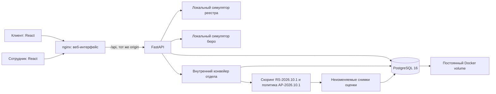
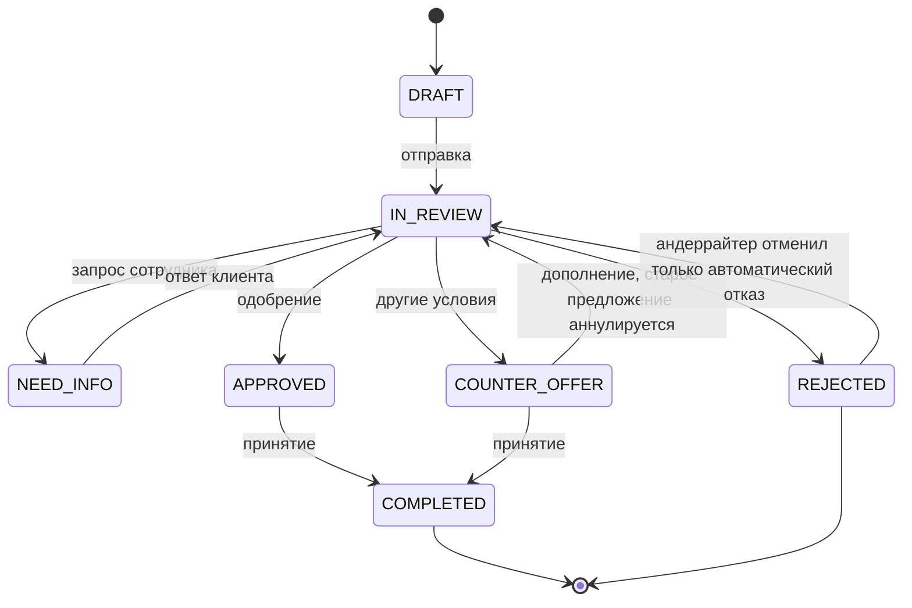
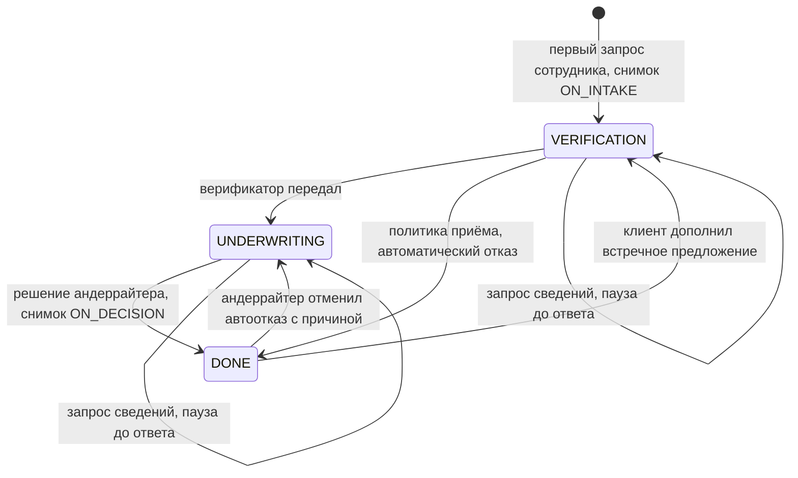
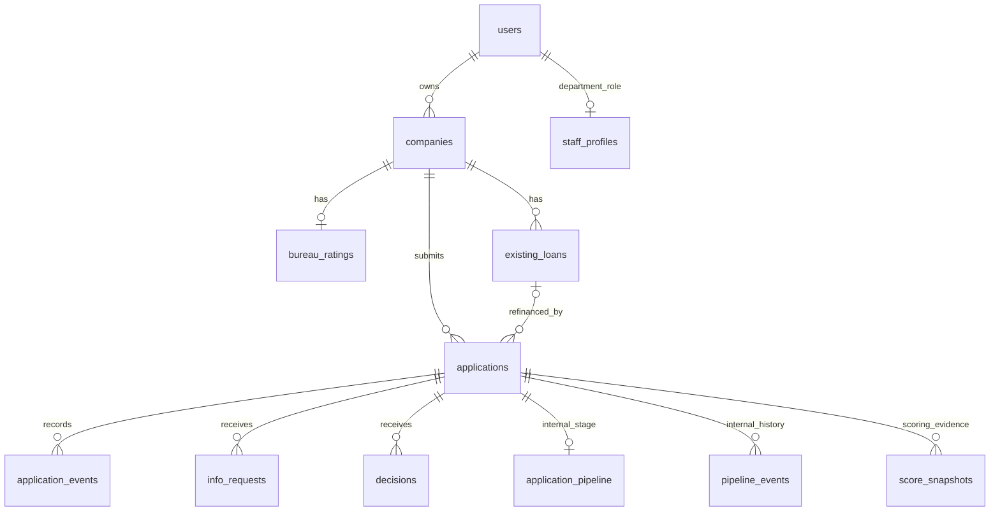

# Архитектура и границы MVP

## Компоненты

Единое React-приложение с разделением по ролям. Сервер проверяет принадлежность данных и права, а не полагается на скрытые кнопки. httpOnly-cookie работает на одном origin: frontend не сохраняет токен в localStorage. localStorage содержит только последний выбранный ID компании, отдельно для каждого пользователя. Никаких CDN, внешних шрифтов или платных сервисов основному интерфейсу не нужно. Swagger backend использует внешние ассеты своей стандартной страницы; сама схема JSON доступна локально, а коллекция запросов находится в репозитории.

В /opt/delo на VPS сохранён исходный backend Compose. Для установки фронта к нему добавлен deploy/compose.frontend.yml: nginx получает порт 80, прямой порт API ограничен 127.0.0.1:8000. PostgreSQL не опубликован наружу. Корневой docker-compose.yml в этом комплекте запускает все три компонента из исходников на обычном ПК.

## Машина состояний

COMPLETED означает принятие условий в демонстрации. Выдача денег не происходит, действующий кредит автоматически не добавляется.

### Внутренний процесс отдела — клиенту не виден

Верификация — 4 часа, андеррайтинг — 24 часа; ожидание клиента исключается.
Заявку нужно взять в работу, переходы проверяются сервером под блокировкой строки.
Отмена автоотказа сразу закрепляет её за отменившим андеррайтером. Внутренние события
и снимки живут отдельно от клиентской истории. Общие роли и статусы сохранены.

Рекомендация скоринга помогает человеку и сама статус не меняет. Автоматическая
политика приёма действует один раз: рейтинг <300 одновременно с нагрузкой >100%,
при полных данных. Она сохраняет обычное решение REJECTED с причиной LOW_RATING,
снимок оценки, версию политики и внутреннее событие. После отмены автоматически
повторно не применяется. Подробности: [AUTO_REJECT.md](staff-pipeline/AUTO_REJECT.md).

## Модель данных

Поля таблиц, расчёты, каталог продуктов и контракты: BACKEND_PROJECT_MAP.md. Фактический DDL описан SQLAlchemy-моделями backend/app/models.py. Обновление анкеты после запроса сотрудника сохраняется в той же заявке; историю дополнений содержат info_requests и application_events. Отдельной неизменяемой версии всей исходной анкеты нет — ограничение текущего backend.

## Допущения

- Пользователи и компании синтетические; действует заранее созданная демонстрационная авторизация.
- Проверка реестра ограничена форматом номера. Данные бюро заранее подготовлены локально.
- Внутренняя оценка учитывает рейтинг, нагрузку, срок работы, полноту анкеты и сумму к выручке; сотрудник отдельно принимает решение.
- Два кредитных продукта имеют одинаковые лимиты. Различаются назначением; это явно выбранное упрощение.
- Нет документов, электронной подписи, выдачи, платных API, LLM и фонового worker. До результата заявки путь связан внутри продукта; оформление после результата вынесено за границы версии.
- Один API-процесс, PostgreSQL volume и restart policy не равны промышленной отказоустойчивости. Схема обновляется Alembic; перед выпуском сохраняется резервная копия базы. Регулярные бэкапы и многорепличная работа требуют отдельной настройки.
